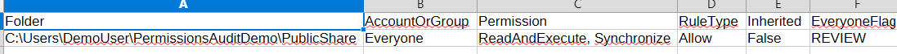
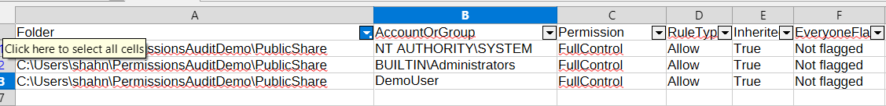

# Windows Folder Permissions Audit (PowerShell)

A PowerShell script that lists the NTFS permissions on a folder and its subfolders, flags any Allow entry granted to the Everyone group, and writes the results to CSV.

## Why

Folder permissions drift over time, and checking them by hand across many folders is slow and easy to get wrong. A script produces the same report every time it runs, so the output from before a fix can be compared directly with the output from after it.

## What it does

1. Scans a target folder and all of its subfolders.
2. Reads each folder's access-control entries with `Get-Acl`.
3. Records the account or group, permission level, rule type (Allow or Deny) and whether the entry is inherited.
4. Flags Allow entries for Everyone, matched by security identifier with an account-name fallback if SID resolution fails.
5. Writes two timestamped CSV files: a full inventory and a list of flagged entries.

The script only reads permissions. It does not change them.

## Requirements

A Windows computer with Windows PowerShell 5.1 or PowerShell 7, and read access to the folders you want to audit. `icacls` was used only to set up the test case described below.

## Running the demo

1. Download [FolderPermissionsAudit.ps1](FolderPermissionsAudit.ps1).
2. Create a folder named `PermissionsAuditDemo` in your Windows user directory.
3. Inside it, create `Finance`, `HR` and `PublicShare`, then add a `Payroll` folder inside `Finance`.
4. Open PowerShell in the directory that contains the script.
5. Run:

   ```powershell
   .\FolderPermissionsAudit.ps1
   ```

6. Open the reports in `%USERPROFILE%\PermissionsAuditReports`.

To audit another folder or choose where reports are saved:

```powershell
.\FolderPermissionsAudit.ps1 -RootFolder 'C:\Data' -ReportFolder 'C:\AuditReports'
```

## Output

Each successful run writes two files with a timestamp (including milliseconds) in the name. Existing reports are never overwritten; a filename collision stops the export with an error.

`AllPermissions` lists every access-control entry found, with the folder path, account or group, permission level, rule type, inheritance status and the Everyone review flag.

`EveryoneFindings` lists only the entries flagged for review. When there are no findings, it still contains the CSV column headings.

## Testing

### Test 1: Detecting an Everyone permission

An explicit Everyone ReadAndExecute permission was added to the `PublicShare` test folder. The audit found it and marked the entry `REVIEW`.



### Test 2: Confirming the fix

The permission was removed with `icacls` and the audit was run again. No entries were flagged.



Sample CSV output, with personal identifiers removed:

- [Test 1: Flagged Everyone entry before correction](Test1_BeforeCorrection.csv) (findings only)
- [Test 2: All permissions after correction](Test2_AllPermissions.csv)

The screenshots are historical examples; the second shows only the `PublicShare` rows, while the second CSV covers all five demo folders. Screenshot paths may differ from the anonymized CSV paths.

### Regression checks

Run `powershell -NoProfile -ExecutionPolicy Bypass -File .\tests\Verify-Audit.ps1` from the repository folder. These checks simulate ACL responses, write reports to a temporary test folder, and do not change permissions. They cover Everyone Allow/Deny rules, empty findings headers, missing roots, unreadable ACLs, and report overwrite protection.

## Limitations

The script reads NTFS access-control entries only. It does not calculate effective access, expand nested group membership or assess SharePoint Online permissions.

A flagged Everyone entry means the folder needs a closer look. Whether anyone actually has unwanted access also depends on Deny rules, inheritance and group membership.

Folders the script cannot open or read may be missing from the report and should be checked separately. Discovery errors and folders whose permissions could not be read are reported as warnings and counted in the summary. Zero findings with incomplete coverage does not mean all folders are clear.
